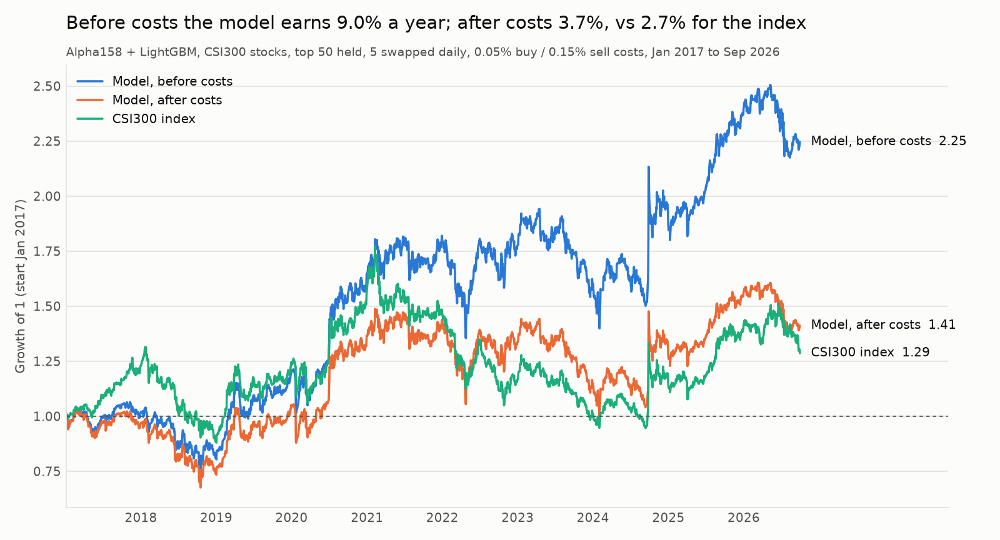
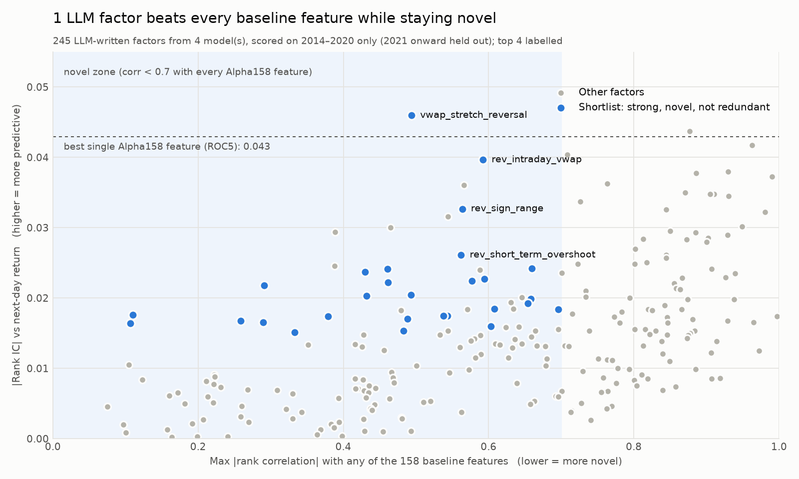
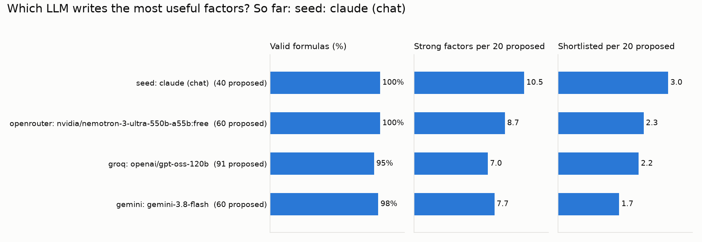
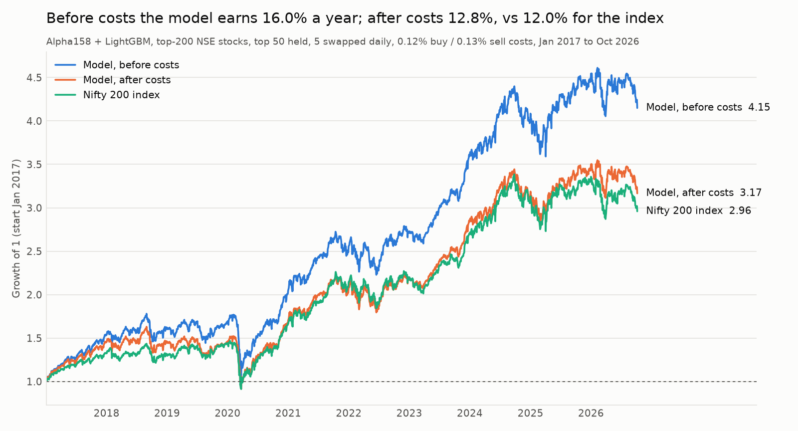
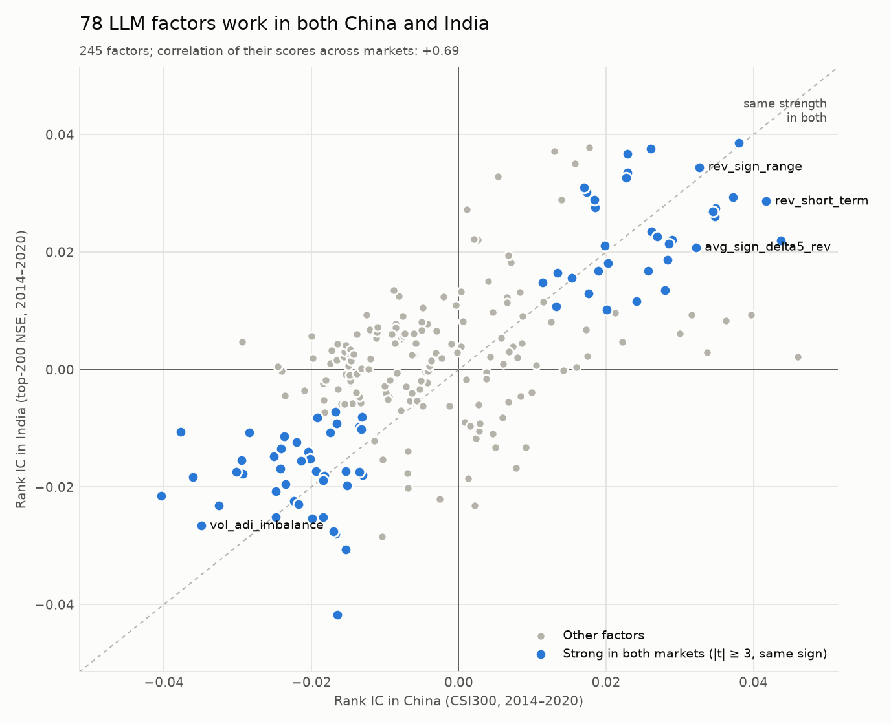
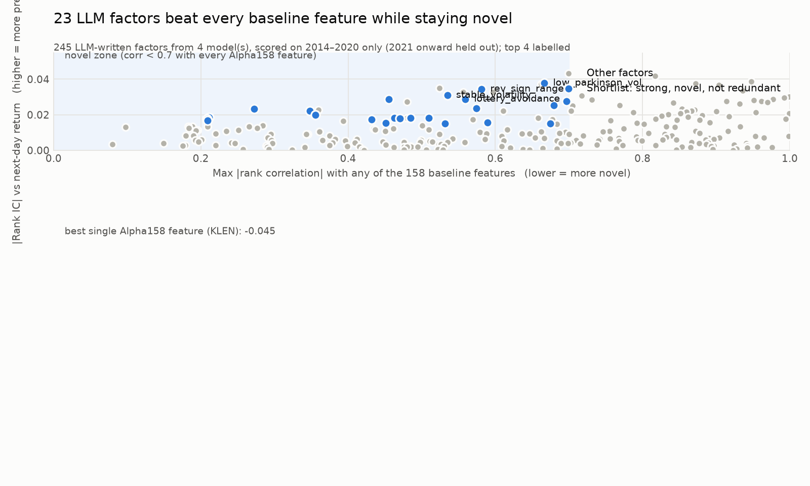
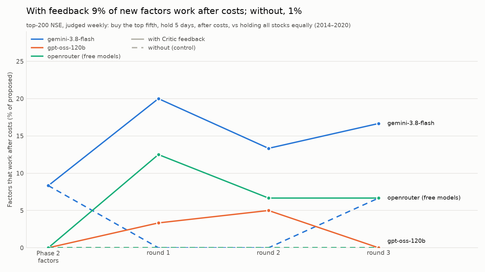
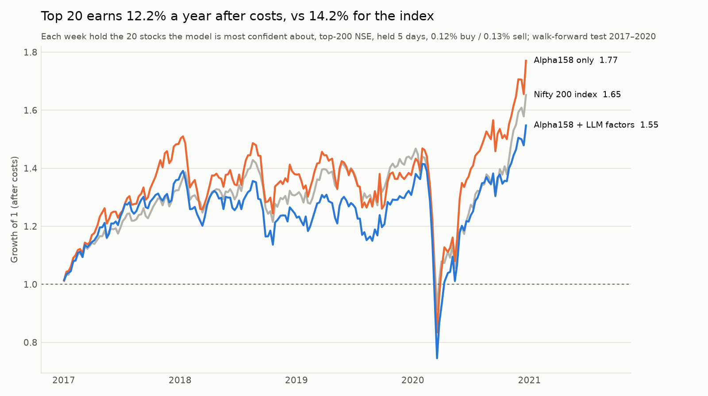
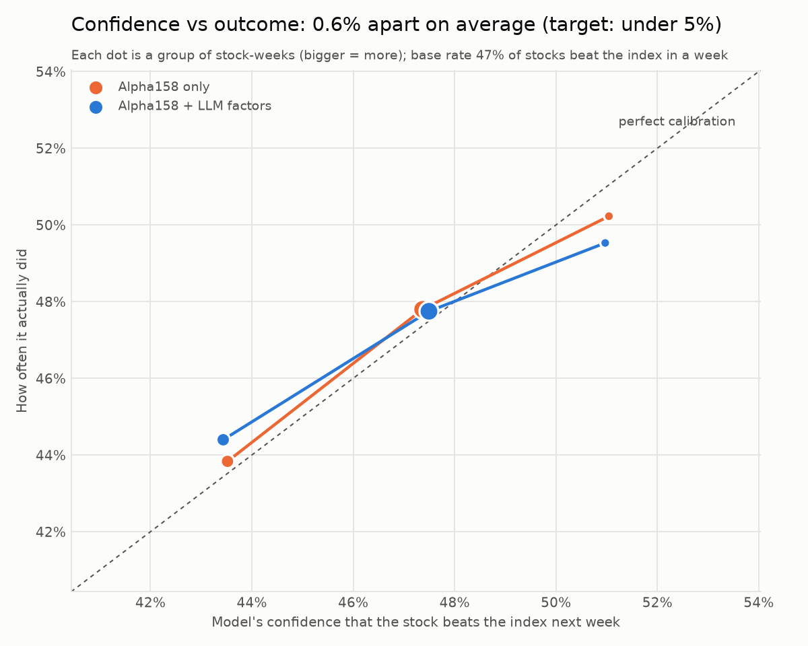
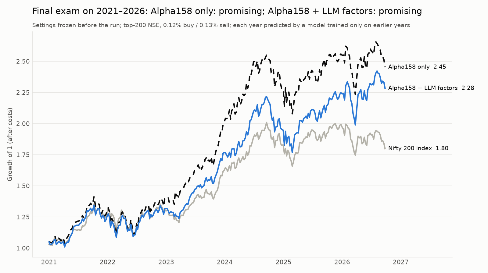

# LLM Alpha Discovery: honest evaluation

[](https://github.com/Chaitya2085/LLM-Alpha-Discovery/actions/workflows/tests.yml)

Large language models invent their own stock-picking signals ("alpha factors"), a
filtering system tests them, and the whole thing is checked rigorously enough to
tell genuine discovery from an LLM simply remembering what happened in the market.

It builds on *Automate Strategy Finding with LLM in Quant Investment* (Kou et al.,
EMNLP 2025, [arXiv:2409.06289](https://arxiv.org/abs/2409.06289)), which reports
+53.17% on China's SSE50 from Jan 2023 to Jan 2024. Our version adds:

- **Several LLMs, mostly free** (Gemini, Groq, Cerebras, OpenRouter, Mistral, local
  Ollama, plus paid Claude/OpenAI), compared side by side
- **A safe factor language**: LLMs write formulas, not code, so nothing they write
  can run anything harmful, and no formula can peek at future prices
- **A held-out test period**: factors are chosen on 2014–2020 only; 2021 onward is
  untouched until the final test
- **Realistic trading**: point-in-time index membership, China's price-limit rules,
  and trading costs
- **A leakage test** (Phase 6): do models that were trained *before* the test years
  do as well as models trained *after*?
- **Built for India** (Phase 3 on): NSE stocks, Indian trading costs and rules, and a
  product designed around SEBI's rules for research and investor education
- **An AI agent team and a web app** (Phases 7–8): agents run the research on a live
  "trading floor", with rankings, confidence scores and plain-English/Hindi reasons

| Phase | What | Status |
|---|---|---|
| 1 | China data, backtester, baselines (the paper's market) | **Done** |
| 2 | LLM factor generation (many providers) and scoring | **Done** |
| 3 | Indian market data: NSE pipeline, Nifty baselines, Indian costs and rules | **Done** |
| 4 | Feedback loop: Researcher and Critic agents, judged weekly after costs | **Done** |
| 5 | Prediction model: combined factors, calibrated confidence, market regimes | **Done** |
| 6 | Final exam on held-out years, leakage test, prediction ledger | **Built, run on your Mac** |
| 7 | AI agent team: the "trading floor" | |
| 8 | Web app: war room, research lab, track record (English and Hindi) | |
| 9 | Compliance review, deploy, demo video, final report | |

The full plan, with accuracy targets, SEBI rules and what each phase delivers, is in
**[ROADMAP.md](ROADMAP.md)**.

---

## Quick start

Needs Python 3.10+, about 8 GB RAM and 2 GB free disk.

```bash
python -m venv .venv
source .venv/bin/activate              # Windows: .venv\Scripts\activate
pip install -r requirements.txt

python run_phase1.py                   # ~10 min: data, features, baselines, chart, README table
cp .env.example .env                   # then paste at least one free API key into .env
python src/llm.py check                # confirms which keys work
python run_phase2.py --provider gemini groq    # LLMs write factors; scored, charted, README updated

python run_india.py --test             # check NSE downloads work on your network
python run_india.py                    # India: download (30-60 min first time), build, score, compare
python run_phase4.py --providers gemini groq   # feedback rounds: Researcher and Critic agents
python run_phase5.py                   # weekly prediction model with calibrated confidence
python run_phase6.py --freeze          # freeze every setting for the final exam, then commit it
python run_phase6.py                   # the final exam on 2021 onward + leakage test
python run_ledger.py                   # weekly: fingerprint this week's predictions
```

Every chart in this README is produced by code into `figures/`, and every results
table is filled in by `src/report.py` from the files in `results/`.

## LLM providers

All free options below need no credit card. Free tiers and model names change, so
`python src/llm.py models --provider <name>` lists what your key can use, and any
model can be chosen with `--model` or `<NAME>_MODEL` in `.env`.

| Provider | Free? | Get a key | `.env` variable | Default model |
|---|---|---|---|---|
| `gemini` (Google AI Studio) | Yes | [aistudio.google.com/apikey](https://aistudio.google.com/apikey) | `GEMINI_API_KEY` | `gemini-3.8-flash` |
| `groq` | Yes | [console.groq.com/keys](https://console.groq.com/keys) | `GROQ_API_KEY` | `openai/gpt-oss-120b` |
| `cerebras` | Yes | [cloud.cerebras.ai](https://cloud.cerebras.ai) | `CEREBRAS_API_KEY` | `qwen-3.8-27b` |
| `openrouter` (`:free` models) | Yes, 50 requests/day | [openrouter.ai/keys](https://openrouter.ai/keys) | `OPENROUTER_API_KEY` | picks a currently free model automatically |
| `mistral` | Yes, low limits | [console.mistral.ai](https://console.mistral.ai/api-keys) | `MISTRAL_API_KEY` | `mistral-small-latest` |
| `ollama` (your computer) | Yes, no key | [ollama.com/download](https://ollama.com/download) | none | `qwen3:8b` |
| `anthropic` (Claude) | Paid | [console.anthropic.com](https://console.anthropic.com) | `ANTHROPIC_API_KEY` | `claude-sonnet-5-5` |
| `openai` | Paid | [platform.openai.com](https://platform.openai.com/api-keys) | `OPENAI_API_KEY` | set with `--model` |

Notes: thinking models on free tiers are slow (a batch of 20 factors can take a few
minutes), so the client waits up to 15 minutes per request. On Google's free tier, prompts may be used to improve Google's products
(fine here, since nothing private is sent). Hugging Face no longer includes free
inference credits for free accounts, so it isn't listed; its open models can be run
locally through Ollama instead. Every LLM reply is saved in `llm_runs/`, so any run
can be re-scored later without calling the API again.

---

## Phase 1: data, backtester and baselines



Daily prices for every stock that was in China's CSI300 index since 2014 (700
different stocks, kept even after they left the index), a day-by-day trading
simulator, and the strategies professionals already use.

<!-- AUTO:phase1_table -->
| Strategy | Rank IC | ICIR | Gross / yr | Net / yr | Excess vs index / yr | Info ratio | Max drawdown | Costs / yr | Paper window* |
|---|---|---|---|---|---|---|---|---|---|
| Reversal 5d | 0.021 | 0.11 | 1.4% | −3.0% | −5.4% | −0.40 | −57.4% | 4.4% | −36.2% |
| Momentum 60d | −0.002 | −0.01 | 3.9% | 0.6% | −1.8% | −0.04 | −59.2% | 3.2% | −8.6% |
| Low volatility 20d | 0.018 | 0.08 | 4.2% | 0.2% | −4.0% | −0.29 | −32.9% | 3.9% | −1.5% |
| Price-volume corr 20d (neg) | 0.015 | 0.09 | 8.4% | 3.7% | +0.6% | 0.11 | −48.9% | 4.4% | −25.8% |
| **Alpha158 + LightGBM** | 0.045 | 0.29 | 8.2% | 3.2% | +0.0% | 0.05 | −33.9% | 4.8% | −20.9% |
| CSI300 index (buy & hold) |  |  |  | 2.9% | +0.0% |  | −46.7% |  | −17.1% |
| Equal-weight CSI300 (gross) |  |  |  | 3.0% | +0.0% |  | −35.0% |  | −15.6% |

Test period 2 Jan 2017 to 8 Oct 2026 (the last year is year-to-date). \*Paper window = 1 Jan 2023 to 31 Jan 2024, where the paper reports +53.17%.
<!-- /AUTO:phase1_table -->

**What we learned**

1. **The machine-learning baseline genuinely predicts returns.** LightGBM on Qlib's
   158 handcrafted factors reaches a rank IC of about 0.045, in line with Qlib's own
   published numbers, which also confirms the data and pipeline are right.
2. **Trading costs eat that edge.** The signal lasts about a day, so the model has to
   trade constantly. Before costs it earns roughly three times the index; after
   costs it is about level with it. Refreshing all 50 stocks daily would earn about
   21% a year gross but cost about 32% a year. **A useful signal has to survive
   costs, not just predict.**
3. **The paper's test year was a losing year for everyone.** Over Jan 2023 to Jan
   2024 the CSI300 fell about 17% and every baseline lost money, which makes a +53%
   result a red flag worth testing (Phase 6).
4. **Classic single factors don't beat the index** long-only after costs.

**Checks:** index returns match the index's published levels; the backtester
matches an independent vectorised calculation (21.3% vs 21.4% gross); a random
signal shows no edge; the regression features match `numpy.polyfit` exactly.

---

## Phase 2: LLMs write factors



Each LLM gets the same prompt (`src/prompts.py`): the factor language, how factors
are used, and the baseline families to avoid copying. The prompt never names the
market, country, tickers or dates. Replies are parsed, validated, de-duplicated
and scored on **Jul 2014 to Dec 2020 only**.

<!-- AUTO:phase2_summary -->
- Discovery period: **1 Jul 2014 to 28 Dec 2020** (2021 onward is held out)
- Factors proposed: **40** from **1** model(s); valid and scored: **40**
- Strong: **21** · novel: **22** · shortlisted: **8**
- Reference: best single Alpha158 feature is ROC5 (rank IC 0.043, t 8.7); median feature |rank IC| 0.018
<!-- /AUTO:phase2_summary -->

**Which LLM writes the most useful factors?**



<!-- AUTO:phase2_models -->
| Model | Proposed | Valid | Invalid | Duplicate | Strong | Shortlisted | Wrong sign | Best factor |
|---|---|---|---|---|---|---|---|---|
| seed: claude (chat) | 40 | 100% | 0% | 0% | 21 | 8 | 28% | `vwap_stretch_reversal` (+0.046) |
<!-- /AUTO:phase2_models -->

**Shortlist** (strong: |t| ≥ 3, |rank IC| ≥ 0.015, same sign in ≥ 70% of years;
novel: correlation < 0.7 with every Alpha158 feature; unique: correlation < 0.7 with
any stronger LLM factor). "Flipped" means the factor works in the opposite
direction to the LLM's hypothesis.

<!-- AUTO:phase2_shortlist -->
| Factor | From | Expression | Rank IC | t | Day-to-day stability | Top-fifth excess / yr | Closest baseline feature |
|---|---|---|---|---|---|---|---|
| `vwap_stretch_reversal` | seed: claude (chat) | `-Decay(close / vwap - 1, 10)` | +0.046 | +10.9 | 0.82 | +19.1% | 0.49 (RSV10) |
| `volume_stability` | seed: claude (chat) | `-Std(Log(volume), 40)` | +0.024 | +6.2 | 0.99 | +9.9% | 0.46 (WVMA60) |
| `intraday_over_overnight` (flipped) | seed: claude (chat) | `Mean(close / open - 1, 20) - Mean(open / Ref(close, 1) - 1, 20)` | −0.024 | −5.8 | 0.95 | +5.5% | 0.59 (ROC20) |
| `low_idiosyncratic_vol` | seed: claude (chat) | `-Std(CsDemean(returns), 40)` | +0.023 | +4.8 | 0.99 | +3.4% | 0.59 (STD30) |
| `volume_spike_fade` | seed: claude (chat) | `-TsMax(volume, 20) / Mean(volume, 60)` | +0.022 | +6.1 | 0.95 | +5.7% | 0.46 (WVMA20) |
| `lottery_avoidance` | seed: claude (chat) | `-TsMax(returns, 20)` | +0.018 | +3.7 | 0.96 | −3.1% | 0.63 (MIN30) |
| `stable_volatility` | seed: claude (chat) | `-Std(Std(returns, 10), 40)` | +0.017 | +3.9 | 0.99 | +3.4% | 0.49 (STD60) |
| `pv_rank_divergence` | seed: claude (chat) | `-Corr(CsRank(returns), CsRank(volume), 20)` | +0.015 | +5.6 | 0.92 | +2.4% | 0.48 (CORD20) |
<!-- /AUTO:phase2_shortlist -->

**What we learned from the first batch.** The first 40 factors (`llm_runs/seed/`)
were written by Claude in the chat session where this project was designed,
answering the exact prompt above before any factor was scored. They are kept as a
labelled baseline; `--no-seed` leaves them out.

1. **One genuinely new, strong signal:** `vwap_stretch_reversal` (stocks that keep
   closing above the day's average traded price tend to fall back) beat every
   baseline feature, held in all 7 discovery years, and overlaps at most 0.49 with
   the 158 baseline features. Its t-stat of about 11 is far beyond what 40 tries
   could produce by luck.
2. **The LLM's market intuition was often wrong-signed:** 7 of 8 momentum ideas
   worked backwards, because China large caps tend to reverse rather than trend.
3. **Most strong ideas were restatements** of existing reversal features
   (correlation 0.87–0.99); without the novelty check they would look like
   discoveries.
4. **Predictive is not the same as useful long-only:** some factors only spot
   losers, which a fund that only buys can't use. Phase 3 filters on top-fifth
   performance after costs.

**Checks:** 19 automated tests (unsafe code rejected; operators match pandas; changing
future prices never changes past factor values; the LLM client handles every
provider format, rate limits, bad keys and messy replies); the top factor's IC was
recomputed independently with scipy (identical); a time-shuffled placebo gives
an IC of about zero.

---

## Phase 3: India (NSE)



The same pipeline, now on the Indian market. Everything is built from NSE's official
daily files, downloaded on your computer by `python run_india.py`.

- **Data:** NSE's daily equity bhavcopy (every listed stock, including later-delisted
  ones) and NSE's daily index closes. Both of NSE's file formats are handled (it changed
  format on 8 July 2024).
- **Companies only:** ETFs and fund units also trade in NSE's EQ series; they're dropped
  by ISIN (company ISINs start with INE).
- **Splits, bonuses, demergers:** NSE's daily file has no corporate-action column and
  doesn't adjust the previous close, so they're found in the data. A **split** gets a new
  ISIN in India, so an ISIN change within a few days plus a price jump to a face-value
  ratio (1:2, 1:5, 1:10) is a split. A **bonus** keeps its ISIN; a drop to a bonus ratio
  (1/2, 1/3, ...) is a bonus, and a small bonus (1:2, 2:5, 1:3) counts only if the
  opening price also sits on the ratio, since the exchange resets the price that morning.
  Any other one-day drop to 60% or less (demergers, capital reductions) is treated as
  return-neutral. Real crashes that big are rare in top-200 stocks and are listed in
  `config/india_overrides.csv` as real moves (Yes Bank 2020, DHFL 2018, Jet Airways 2019);
  that file is also where a missed bonus can be added. Every event is in
  `corporate_actions.csv` (check with `python src/india_diagnose.py`).
  Dividends aren't adjusted, matching the Nifty price indices.
- **Universe:** each month, the 200 most-traded EQ stocks over the previous three months
  (point-in-time, no survivorship bias). **Benchmark:** Nifty 200.
- **Indian trading:** 0.12% to buy and 0.13% to sell (STT, stamp duty, exchange fees,
  DP charge); a stock locked at its circuit limit can't be traded at the open.

<!-- AUTO:india_data -->
_Run `python run_india.py` to fill this summary._
<!-- /AUTO:india_data -->

<!-- AUTO:india_phase1_table -->
_Run `python run_india.py` to fill this table._
<!-- /AUTO:india_phase1_table -->

**Do the LLM factors work in India too?** Each factor is scored on India's 2014–2020
data exactly as it was on China's.



<!-- AUTO:india_transfer -->
_Run `python run_india.py` to fill this comparison._
<!-- /AUTO:india_transfer -->



<!-- AUTO:india_phase2_summary -->
_Run `python run_india.py` to fill this summary._
<!-- /AUTO:india_phase2_summary -->

<!-- AUTO:india_phase2_shortlist -->
_Run `python run_india.py` to fill this table._
<!-- /AUTO:india_phase2_shortlist -->

**Checks:** 7 India tests on a synthetic NSE archive (both file formats, splits and
bonuses, demergers and manual overrides told apart from a genuine crash, ETFs, weekend special sessions, holidays,
listings and delistings, locked circuits, blocked downloads, NSE "busy" errors, resume).
`python src/india_diagnose.py` lists every adjustment and the biggest remaining moves on
the real data. The whole India pipeline was also run on 11 years of synthetic **random-walk** prices: every
factor and the LightGBM model showed no edge (largest |t| 1.3, rank IC ≈ 0), which is
the right answer and shows nothing in the pipeline peeks at the future.

*Indian data is used here for research. Under SEBI's rules, public educational use needs
price data at least 30 days old, and specific stock recommendations need SEBI
registration (see [ROADMAP.md](ROADMAP.md)).*

---

## Phase 4: the feedback loop



Each LLM becomes a **Researcher**. A **Critic** reads the test results and tells it, in
plain words, what worked and what didn't; the Researcher then tries again. The question
is simple: *does feedback make an LLM a better researcher?*

- **Judged the way the product would trade:** every week, buy the top fifth of stocks by
  the factor, hold them 5 trading days, pay Indian trading costs, and compare with simply
  holding all stocks equally. Long-only, and the factor is used exactly as proposed
  (never flipped for it). 2014–2020 only; later years stay untouched.
- **The Critic is rule-based**, so every verdict traces to a number: *works after costs*,
  *works in reverse*, *too costly* (real signal, but the portfolio churns),
  *copy* (ranks stocks like a known feature or an earlier factor), *unstable*, *no
  signal*, or *broken*. Its feedback never mentions a market, dates or tickers.
- **A control arm:** the same LLM is also asked for the same number of factors without
  feedback. If feedback helps, the feedback arm should find more factors that work.
- Round 0 is each LLM's Phase 2 factors, so the first feedback is about its own earlier
  ideas. Everything (prompts, replies, the Critic's notes) is saved, and
  `python run_phase4.py` with no providers rebuilds every table from the library.

<!-- AUTO:phase4_summary -->
_Run `python run_phase4.py --providers gemini groq` to fill this summary._
<!-- /AUTO:phase4_summary -->

**Best new factors** (work weekly after costs):

<!-- AUTO:phase4_best -->
_Run `python run_phase4.py --providers gemini groq` to fill this table._
<!-- /AUTO:phase4_best -->

**Read with care:** the Critic's feedback comes from the same 2014–2020 data the next round
is judged on, so part of the feedback arm's edge may be tuning to that period rather than
better ideas. Phase 6 settles it on 2021 onward, which no agent has seen, with the
number of ideas tried taken into account.

**Why this bar is high:** judged this way on China's 2014–2020 data, only 10 of the 251
Phase 2 factors work after costs (none of gpt-oss's 91), because a factor has to pick
winners among the stocks it *likes*, not just rank the losers, and has to do it without
churning the portfolio. That's the bar a real product has to clear.

**Checks:** 3 Phase 4 tests on a synthetic market with one planted effect and a fake LLM
that only fixes its mistakes when told about them: the weekly judge finds the effect and
charges costs correctly, every Critic verdict fires on the right numbers, the feedback arm
beats the control arm, and no prompt contains a year or a market name.

## Phase 5: the prediction model



One model that combines everything that passed so far into a weekly answer to the question
users care about: **how likely is this stock to beat the Nifty 200 over the next 5 trading
days?**

- **Inputs:** the 158 standard Alpha158 features, the LLM factors that passed (Phase 2
  shortlist and Phase 4 "works after costs"), and the market's mood (trend, volatility, how
  spread out stocks are).
- **Walk-forward:** each test year is predicted by a model trained only on earlier years.
  Nothing after 2020 is even loaded; 2021 onward is the Phase 6 final test.
- **Confidence that means what it says:** each week the model's scores become ranks, and the
  rank is calibrated on the previous year into a probability. The chart below checks it:
  stocks given "48%" should beat the index about 48% of the time.
- **Two books, after costs:** *Top 20* holds the 20 stocks with the highest confidence (a
  holding stays while it's in the best 60, to save trading costs). *Confident only* holds only
  stocks at least 50% likely to beat the index and parks the rest in the index ("abstain when
  unsure").
- **Does the LLM help?** Two versions are trained: Alpha158 only, and Alpha158 + LLM factors.
- **How to trade it** is chosen from a small fixed menu (20 or 40 stocks; keep a holding while
  it's in the top 3x or 5x; trade every 1 or 2 weeks). Every option is shown below; the one
  with the best information ratio after costs is carried into Phase 6, which is told how many
  options were tried.

<!-- AUTO:phase5_table -->
_Run `python run_phase5.py` to fill this table._
<!-- /AUTO:phase5_table -->

**Every trading design tried** (same predictions, different ways to trade them):

<!-- AUTO:phase5_grid -->
_Run `python run_phase5.py` to fill this table._
<!-- /AUTO:phase5_grid -->



**By market regime** (Top 20 book):

<!-- AUTO:phase5_regimes -->
_Run `python run_phase5.py` to fill this table._
<!-- /AUTO:phase5_regimes -->

**What the numbers can and can't say:** a stock's chance of beating the index in one week is
close to a coin flip for everyone; an honest model's confidence lives roughly between 35% and
60%, never 80–90%. The edge is in the *ranking*: small differences, applied to 20 stocks every
week, add up. The LLM factors were picked using 2014–2020, which overlaps these test years, so
Phase 6 on 2021 onward is the real verdict.

**Checks:** 4 Phase 5 tests on a synthetic market with one planted effect: the model finds it
and relies on it, its confidence is calibrated (within 5%), a market with no effect gives no
skill, scrambling every price after 2020 changes no prediction, and it refuses to test on 2021+.

## Phase 6: the final exam



Everything so far was decided using 2014–2020. Phase 6 runs the model **once** on 2021 to today,
years that no choice in this project has looked at.

- **Frozen first:** the trading design (40 stocks, keep while in the top 120, weekly), the model
  settings, the exact list of LLM factors and the pass marks are written to
  `config/phase6_frozen.json` and committed to git **before** the exam, so the promise is
  timestamped before the result exists. `run_phase6.py` refuses to start until it is committed.
- **One shot:** every run is logged in `results/india/phase6_runlog.json`; a second run must give a
  reason, and the number of runs is shown below.
- **Both versions:** Alpha158 only, and Alpha158 + LLM factors, so the exam also answers whether the
  LLM factors help on unseen years.
- **Luck counted:** the verdict uses the **Deflated Sharpe Ratio**, the probability that the
  after-cost edge is real once you count the 16 trading designs tried in Phase 5.
  **Real edge** = positive and at least 95% after counting tries; **promising** = 95% before
  counting tries; otherwise **no proven edge**.

<!-- AUTO:phase6_table -->
_Run `python run_phase6.py` to fill this table._
<!-- /AUTO:phase6_table -->

### Leakage test: invention or memory?

Every LLM read text up to a cutoff date. A model that *remembered* which stocks did well would write
factors that work in years it read about and fade right after its cutoff. Each model's factors are
scored before and after its cutoff, and compared with every other model's factors over the same
dates, because ideas also fade for ordinary reasons. Cutoffs are entered in `config/llm_cutoffs.csv`
from each model's model card.

<!-- AUTO:leakage_table -->
_Run `python run_phase6.py` to fill this table._
<!-- /AUTO:leakage_table -->

### The prediction ledger

From now on, every week's predictions are made **before** the week starts and fingerprinted
(SHA-256, each entry chained to the one before) in `ledger/commitments.csv`, which is committed to
git. The predictions themselves stay in `ledger/private/` on your computer, because publishing live
calls on named stocks needs SEBI registration. After 31 days each file is revealed in
`ledger/revealed/` and checked against its fingerprint, so nobody (including us) can change or
back-date a prediction. `python src/ledger.py verify` re-checks the whole chain.

<!-- AUTO:ledger_status -->
_Run `python run_ledger.py` each week to start the ledger._
<!-- /AUTO:ledger_status -->

**Checks:** 5 Phase 6 tests: the luck statistics match their formulas; on a synthetic market the
exam is frozen, finds a planted edge and refuses an unrecorded second run; the leakage test flags an
effect that stops exactly at a model's cutoff and not one that doesn't; an edited or back-dated
ledger entry is caught; the ledger records once per day.

## Design choices that keep results honest

- **Point-in-time universe:** a stock is eligible only on days it was actually in the
  CSI300, so there's no survivorship bias.
- **No peeking:** signal at the close of day *t*, trade at the open of *t+1*, earn
  open *t+1* → open *t+2*. The factor language only looks backwards (tested).
- **China market rules:** no buying a stock that opens limit-up, no selling one that
  opens limit-down, no trading suspended stocks.
- **Costs:** 0.05% on buys, 0.15% on sells (Qlib's China defaults).
- **Walk-forward training** for the LightGBM baseline, retrained every January.
- **Held-out period:** factor selection uses 2014–2020 only.
- **Market-blind prompts:** no market, dates or tickers, so the Phase 6 leakage test
  compares like with like.

## Data

**India:** NSE's official daily bhavcopy and index-close files, downloaded by
`src/india_download.py` (resumable; about 6,000 small files from 2014). Not committed to git.
If NSE is busy (HTTP 503/429) the downloader waits and retries; days it still can't get are
listed in `data/raw/india/failed_days.json`, and running `python run_india.py` again fetches
only those.

**China:** daily A-share data in Qlib format from the community-maintained
[chenditc/investment_data](https://github.com/chenditc/investment_data).
`run_phase1.py` downloads it (about 570 MB) and it is not committed to git. It's a free
community dataset, not a vendor feed: suspension days show as missing prices, ST
stocks' 5% limit isn't modelled, and new trading days are added daily, so results
from a later download differ slightly in the latest year.

## Project layout

```
ROADMAP.md               the plan for Phases 3-9
run_phase1.py            data -> features -> baselines -> chart -> README table
run_phase2.py            tests -> LLM factors -> scoring -> charts -> README tables
run_india.py             NSE download -> India dataset -> baselines -> factor scores -> China vs India
run_phase4.py            tests -> feedback rounds per LLM -> tables -> chart -> README tables
run_phase5.py            tests -> weekly model, walk-forward to 2020 -> charts -> README tables
run_phase6.py            --freeze; then tests -> final exam -> leakage test -> chart -> README tables
run_ledger.py            weekly: latest NSE data -> record -> reveal -> score -> verify -> README
src/
  markets.py             per-market settings (paths, costs, rules); --market china|india
  india_download.py      download NSE bhavcopies and index closes (resumable, polite)
  india_parse.py         read both NSE bhavcopy formats and index files
  build_india.py         India dataset: split/bonus detection, ETFs removed, top-200 universe, benchmark
  india_diagnose.py      health check: every split/bonus adjustment and the biggest moves left
  compare_markets.py     do LLM factors work in both China and India?
  qlib_reader.py         read Qlib .bin files without installing Qlib
  build_dataset.py       CSI300 point-in-time panel, tradability flags, quality checks
  data.py                wide (date x stock) matrices and next-day returns
  features.py            Alpha158 baseline factor set
  build_features.py      compute and save the Alpha158 matrix
  backtest.py            Top-K/Dropout backtester with limits, suspensions, costs
  metrics.py             IC, ICIR, returns, Sharpe, drawdown, information ratio
  run_baselines.py       Phase 1 experiments
  dsl.py                 the factor language: safe parser, operators, evaluator
  prompts.py             LLM prompts (market-blind)
  llm.py                 client for all providers; `check` and `models` commands
  generate_factors.py    ask an LLM, validate, de-duplicate, save to the library
  score_factors.py       score on 2014-2020: IC, stability, novelty, per-model summary
  weekly.py              the weekly judge: top fifth, held 5 days, after costs (Phase 4)
  critic.py              the Critic agent: verdicts and plain feedback (rule-based)
  feedback_loop.py       Researcher rounds with and without feedback; Phase 4 tables
  phase5_model.py        weekly model: features, walk-forward LightGBM, calibration, books
  phase6_exam.py         freeze, one-shot final exam on 2021+, verdict with the Deflated Sharpe Ratio
  honest_stats.py        probabilistic and deflated Sharpe ratios (luck counted)
  leakage_test.py        do LLM factors fade right after the model's knowledge cutoff?
  ledger.py              weekly predictions: fingerprint now, reveal after 31 days, score, verify
  style.py               shared chart style
  plot_phase1.py         figures/phase1_growth.png
  plot_phase2.py         figures/phase2_strength_vs_novelty.png, figures/phase2_models.png
  plot_phase4.py         figures/<prefix>phase4_rounds.png
  plot_phase5.py         figures/<prefix>phase5_growth.png, figures/<prefix>phase5_calibration.png
  plot_phase6.py         figures/<prefix>phase6_exam.png
  report.py              fills the README tables from results/
tests/                   test_dsl.py (factor language), test_llm.py (LLM client),
                         test_india.py + fake_nse.py (Indian pipeline on a synthetic NSE archive),
                         test_phase4.py (weekly judge, Critic, feedback loop with a fake LLM),
                         test_phase5.py (model, calibration, no peeking past 2020); synth_market.py,
                         test_phase6.py (exam, luck statistics, leakage test, ledger)
config/india_overrides.csv  manual decisions for corporate actions (real crashes, missed bonuses)
config/phase6_frozen.json   the frozen exam settings and pass marks (committed before the exam)
config/llm_cutoffs.csv      each LLM's knowledge cutoff, for the leakage test
ledger/                     commitments.csv (public fingerprints), revealed/ (31+ days old); private/ never committed
factors/library.jsonl    every proposed factor: valid, invalid (with reason), duplicate
llm_runs/                every raw LLM reply (prompt, reply, model, tokens); Phase 4 in llm_runs/phase4/
results/                 CSV/JSON/parquet outputs
figures/                 all charts
```

## Tests

```bash
python tests/test_dsl.py
python tests/test_llm.py
python tests/test_india.py
python tests/test_phase4.py
python tests/test_phase5.py
python tests/test_phase6.py
```

They need no data and no API keys, and run automatically on GitHub for every push
(`.github/workflows/tests.yml`).

## Authors

Chaitya Nanavati, with Claude (Anthropic) as AI collaborator.

## Disclaimer

Research and education only; not investment advice.

## License

MIT, see [LICENSE](LICENSE).
